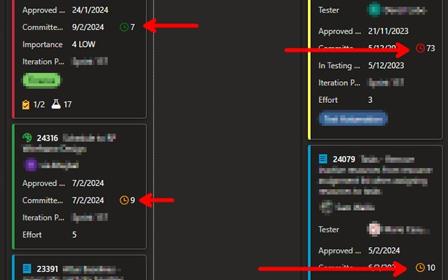
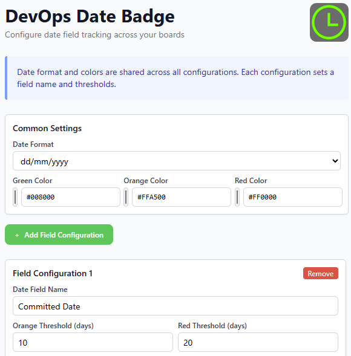

# Azure DevOps Date Badge

Chrome and Edge extension that shows how many days old a work item date is directly on Azure DevOps Board cards.

Available in the Microsoft Edge Add-ons store:
https://microsoftedge.microsoft.com/addons/detail/devops-date-diff-badge/pegeollldhaklallpoiepkeamihedefk

## What It Does

- Adds an age counter badge next to configured date fields on board cards.
- Supports multiple field configurations for different board fields.
- Uses shared date format and shared colors across all field configurations.
- Uses per-field thresholds for orange/red status.
- Works with legacy saved settings and migrates them on save.

## Screenshots

### Board Badges

### Extension Settings

## Supported Azure DevOps URLs

- https://*.visualstudio.com/*/_boards/board/*
- https://dev.azure.com/*/_boards/board/*

## Build And Side Load

1. Install dependencies:

npm install

2. Build the extension package:

npm run build

The build performs:
- Type checking
- Content script TypeScript transpile to content.js
- Vite popup build
- Packaging into dist

3. Load the unpacked extension:
- Open chrome://extensions or edge://extensions
- Enable Developer mode
- Click Load unpacked
- Select the dist folder

The dist folder contains everything required for sideloading:
- manifest.json
- content.js
- service_worker.js
- lib/jquery.min.js
- icons
- popup assets

## How To Use

1. Pin the extension in the browser toolbar.
2. Open an Azure DevOps board.
3. Click the extension icon to open Settings.
4. Configure Common Settings:
- Date format
- Green, orange, and red colors
5. Add one or more Field Configurations:
- Date field name (must match board field label)
- Orange threshold in days
- Red threshold in days
6. Save and refresh the board page.

## Configuration Notes

- Date format and colors apply to all configured fields.
- Each field configuration controls only the field name and thresholds.
- If a card date value cannot be parsed, the badge is not shown for that value.
- Existing older settings are read and normalized automatically.

## Development Commands

- npm run dev
	Starts Vite for popup development.

- npm run typecheck
	Runs TypeScript checks.

- npm test
	Runs Vitest unit tests for content logic.

- npm run build
	Produces a complete loadable extension in dist.
